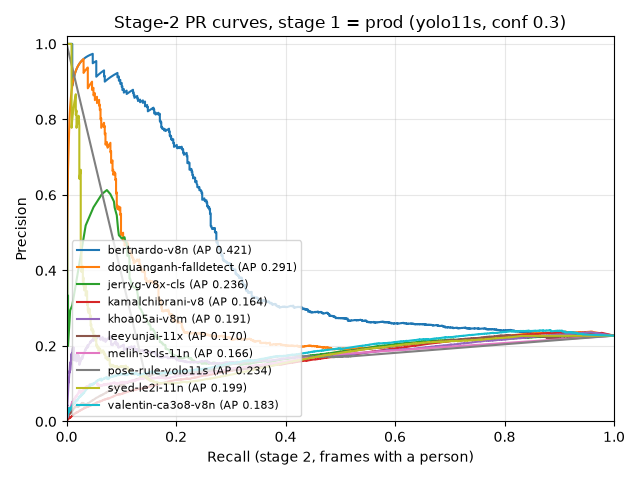

# Báo cáo benchmark mô hình phát hiện ngã (v3)

Ngày: 2026-10-25 · Spec: `docs/specs/2026-10-24-fall-model-benchmark.md` (v1), `…-v2.md` (tập test 40 clip, CI, biến thể pipeline), `…-v3.md` (thêm 4 ứng viên)

Các bảng giữa `<!-- BEGIN GENERATED -->` và `<!-- END GENERATED -->` do `run_benchmark.py` sinh từ `results/`, và `--report-only`
sinh lại y hệt. Phần còn lại viết tay; số liệu lấy từ lần chạy cuối.

## 1. Tóm tắt

- **Không có model nào thắng rõ ràng.** Với 21 clip ngã tính sự kiện, gần như mọi so sánh cặp về điểm sự kiện đều **hoà**:
  CI 95% của hiệu số chứa 0 (mục 9). Thứ hạng bên dưới là kết quả của luật v2 và tie-break, không phải một chiến thắng thống kê.
- **Theo luật v2:**
  - **Stage 2 cho pipeline hiện tại** (`s1=prod`, `trk=prod`): **`bertnardo-v8n`** (Kaggle, YOLOv8n, ghi Apache 2.0).
    Cảnh báo đúng 4/21 clip ngã, **0 cảnh báo sai** trên cả 16 clip không ngã và 5 phút video lớp học, p95 94 ms.
    Model này hoà với `jerryg-v8x-cls` (CI [-3, 7]) và thắng ở tie-break vì cảnh báo sai/giờ thấp hơn (0 so với 1079).
  - **Pipeline đầy đủ:** **`jerryg-v8x-cls|s1=pose|trk=gap1`**. Cảnh báo đúng 11/21 clip ngã (recall 0.52 [0.33, 0.71]),
    nhưng cảnh báo sai 5 clip (815 lần/giờ), p95 73 ms. So với chính jerryg trên pipeline production: +4 điểm sự kiện,
    CI [1, 8] → **khác biệt**. Đây là cải thiện duy nhất có ý nghĩa thống kê trong benchmark.
- **Hai ứng viên đầu thực chất là một đánh đổi**, không bên nào trội hơn:
  - So `jerryg|pose|gap1` với `bertnardo|pose|gap1`: điểm sự kiện hoà (+1, CI [-5, 7]).
  - jerryg bắt **nhiều ca ngã hơn** (recall +0.29, CI [0.10, 0.48]).
  - Đổi lại, jerryg báo sai **nhiều clip hơn** (+5, CI [1, 9]).
  - Chỉ xét clip CCTV thật (`real`), người đứng đầu là `bertnardo-v8n|s1=pose|trk=gap1`.
- **Khuyến nghị thực tế:**
  - **Đổi stage 1 sang `yolo11s-pose`.** Thay đổi này có lợi với mọi model: stage-1 recall 0.755 → 0.812, và p95 còn giảm.
  - **Chọn stage 2 theo mục tiêu:**
    - Ưu tiên không làm phiền: `bertnardo-v8n`, vì không có cảnh báo sai nào trong toàn bộ tập test.
    - Ưu tiên không bỏ sót: `jerryg-v8x-cls` + tracker `gap1`, chấp nhận báo sai khi trẻ em hoặc người lớn ngồi bệt.
  - **Baseline `leeyunjai-11x` không đủ điều kiện.** p95 là 524 ms trên RTX 3060 Laptop, vì YOLO11x chấm từng crop và
    chậm tuyến tính theo số người trong khung hình. So với `bertnardo|pose|gap1`, baseline có nhiều hơn 7 clip báo sai
    (CI [3, 11]), còn recall thì không tốt hơn.
- **Stage 1 vẫn là nút thắt.** Ngay cả với stage 1 `pose`, khoảng 28–52% frame ngã bị bỏ sót vẫn là do không có box người.

## 2. Phương pháp

- **Tập test:** 40 clip.
  - **Clip ngã:** 21 clip đủ dài để tính mức sự kiện (15 CCTV thật từ YouTube, 6 GMDCSA-24), cộng 3 clip URFD `short`
    chỉ dùng ở mức frame.
  - **Clip không ngã:** 16 clip, gồm 1 clip `long` 5 phút (CCTV lớp học, thời gian thực) để tính cảnh báo sai/giờ.
  - **Nhãn của clip YouTube:** gán bằng mắt trên contact sheet 0.5 s (`contact_sheet.py`). Hai clip có thời điểm ngã
    mơ hồ được ghi `uncertain` và loại khỏi phần tính độ trễ.
- **Pipeline:** mỗi pipeline có id dạng `<stage2>|s1=<variant>|trk=<variant>`. Tổng 10 ứng viên × 3 stage 1 × 3 tracker = 90 pipeline.
  - **Stage 1:**
    - `prod` = `yolo11s` với conf 0.3, đúng như `Detector.predict`.
    - `lowconf` = `yolo11s` với conf 0.1.
    - `pose` = box người của `yolo11s-pose` với conf 0.3.
    - Cả ba dùng `imgsz=704`, `max_det=12` và crop vuông bằng `square_crop` (lề 10%).
  - **Tracker:**
    - `prod` = `FallTracker` của FallGuard tại commit `01c3556`. Bản sao nguyên văn nằm trong `benchmark/legacy.py`, vì
      commit `2638a55` đã thay production bằng pipeline Pose + BiLSTM (xem mục 12).
    - `gap1` / `gap2` = `GapTolerantTracker`: giữ track qua 1–2 lần hụt mà không reset `fall_since`. Track đang hụt
      không bao giờ được tính là dương tính và không phát cảnh báo.
- **Mức frame:**
  - Lấy mẫu mỗi 0.3 s và chấm ở ngưỡng 0.4.
  - Frame trong ±0.5 s quanh hai mép khoảng ngã bị bỏ qua.
  - Riêng stage 2 được chấm thêm trên các frame mà stage 1 thấy người, cho ra AP và ROC AUC (tích phân hình thang).
- **Mức sự kiện:** phát lại tracker (3 lần xác nhận và ≥ 5 s) với `now = t`.
  - Một clip ngã "được cảnh báo" nếu có cảnh báo từ `fall_start_s − 0.5` trở đi.
  - "Cảnh báo sai" là clip không ngã có cảnh báo, hoặc clip ngã có cảnh báo trước thời điểm đó.
- **Độ bất định:**
  - Bootstrap 2000 lần, lấy mẫu lại theo clip, phân tầng thành ngã / ngã `short` / không ngã, seed 0.
  - Phép so sánh cặp dùng chung các lần lấy mẫu. "Hoà" nghĩa là CI 95% của hiệu điểm sự kiện chứa 0.
- **Nơi chạy:**
  - **Độ chính xác:** chạy trên Kaggle (T4 ×2, notebook private, `kaggle_bundle.py`), mỗi GPU chấm một nửa số ứng viên.
    Kết quả trùng khớp với lần chạy local cho các pipeline đã có, ví dụ `jerryg|s1=prod|trk=gap1` = 9/21 và 5 clip báo sai.
  - **Độ trễ:** đo local trên **RTX 3060 Laptop (6 GB)** bằng `--latency-only`.
    - Mẫu cố định 200 frame có người, seed 0, lần lượt qua từng clip; trung bình 3.1 người mỗi frame, tối đa 12.
    - Mỗi frame đo stage 1 + crop + stage 2, có CUDA synchronize.
    - Mỗi vòng đo lần lượt cả 10 model; có 5 vòng.
    - Ngưỡng 200 ms áp cho **trung vị của p95 qua các vòng**.
- **An toàn khi load weights:** mọi file đều pin sha256, hash được kiểm ngay trước khi load, và bật `ULTRALYTICS_SAFE_LOAD=1`.
  Weights từ Kaggle được tải bằng token đọc từ biến môi trường; token không được gửi theo redirect.

## 3. Tập test

<!-- BEGIN GENERATED: clips -->
| clip_id | Nguồn | Góc nhìn | Ánh sáng | Loại | Ngã (s) | Ghi chú | File |
|--|--|--|--|--|--|--|--|
| yt_carehome_chair | youtube | wall | ir | ngã | 7.0–26.0 | real care-home CCTV; elderly woman slumps against the armchair then slides to the floor (~7-8.5 s) and lies to the end; times checked on 0.5 s frames | có |
| yt_atm_collapse | youtube | ceiling | day | ngã | 0.8–11.0 | real CCTV; man collapses at an ATM; zoomed replay then cut to the wide shot at ~2.5 s; two helpers cross the frame ~5-10 s; trimmed to skip a first replay and the interview; times checked on 0.5 s frames | có |
| yt_doorbell_porch | youtube | wall | day | ngã | 10.0–17.7 | real doorbell camera; man leans on the railing then sinks to his knees and lies prone from ~11.5 s; trimmed before the interview; times checked on 0.5 s frames | có |
| yt_office_staged | youtube | ceiling | day | ngã | 7.5–19.2 | real office surveillance; staged fraud fall (lowers himself) at ~7.5-8.5 s then lies; caption overlays; times checked on 0.5 s frames | có |
| gmd_s2_fall04 | GMDCSA-24 | wall | day | ngã | 3.3–10.0 | backward fall after looking out of a window; annotated | có |
| gmd_s2_fall10 | GMDCSA-24 | wall | night | ngã | 2.0–11.0 | night; side fall then rolls onto the back; annotated | có |
| gmd_s2_fall19 | GMDCSA-24 | wall | day | ngã | 8.2–15.0 | eating while standing then forward fall; annotated | có |
| gmd_s3_fall05 | GMDCSA-24 | wall | day | ngã | 3.2–10.0 | slow fall from standing to the floor; annotated | có |
| gmd_s3_fall07 | GMDCSA-24 | wall | day | ngã | 1.0–9.0 | backward fall from standing; annotated | có |
| gmd_s3_fall18 | GMDCSA-24 | wall | night | ngã | 4.2–11.0 | night; sitting on the bed then falls to the floor; annotated | có |
| urfd_fall01_cam1 | URFD | ceiling | day | ngã | 2.733–5.3 | short; overhead camera; annotated (cam0 frame labels at 30 fps); crop=right (file is depth\|RGB side by side) | có |
| urfd_fall10_cam1 | URFD | ceiling | day | ngã | 1.3–4.3 | short; overhead camera; annotated (cam0 frame labels at 30 fps); crop=right (file is depth\|RGB side by side) | có |
| urfd_fall20_cam1 | URFD | ceiling | day | ngã | 0.567–3.633 | short; overhead camera; annotated (cam0 frame labels at 30 fps); crop=right (file is depth\|RGB side by side) | có |
| gmd_s4_adl10 | GMDCSA-24 | wall | day | không ngã | — | hard negative: walks then lies down on the bed | có |
| gmd_s1_adl01 | GMDCSA-24 | wall | day | không ngã | — | hard negative: sits on the bed then lies on it | có |
| gmd_s2_adl09 | GMDCSA-24 | wall | day | không ngã | — | hard negative: gets up from the bed then sits on the floor | có |
| gmd_s1_adl15 | GMDCSA-24 | wall | day | không ngã | — | hard negative: bends to pick a phone off the floor then sits on a chair | có |
| gmd_s2_adl22 | GMDCSA-24 | wall | night | không ngã | — | hard negative: night; push-ups then sits | có |
| gmd_s3_adl06 | GMDCSA-24 | wall | day | không ngã | — | hard negative: floor exercises then sits down on the floor | có |
| urfd_adl30_cam0 | URFD | wall | day | không ngã | — | hard negative: walks in and deliberately lies down on the floor rug (~7-13 s); crop=right (file is depth\|RGB side by side) | có |
| yt_cardiac_street | youtube | ceiling | day | ngã | 11.5–42.5 | real outdoor CCTV, far camera so the person is small; man walks then collapses ~11.5-12.5 s and lies; helpers arrive ~15 s and kneel around him from ~24 s; trimmed before a zoomed cut; times checked on 0.5 s frames | có |
| yt_karate_hall | youtube | wall | day | ngã | 6.0–33.5 | real fixed cameras in a karate hall; instructor collapses ~6-6.5 s; cut to a second wide camera at ~10 s where he lies at the left (partly hidden ~10-11.5 s); helpers kneel from ~20 s; cut to a closer camera at ~25.5 s; caption overlays; times checked on 0.5 s frames | có |
| yt_drunk_work | youtube | ceiling | day | ngã | 9.5–17.0 | real store CCTV; worker staggers and falls ~9.5-10.5 s and lies on his side; trimmed when he sits up on the floor (~17 s); times checked on 0.5 s frames | có |
| yt_ring_heat | youtube | wall | day | ngã | 2.0–36.5 | real Ring doorbell (fisheye); man collapses ~2-3.5 s and lies along the bottom edge, mostly out of frame; caption overlays; neighbour arrives ~34 s; times checked on 0.5 s frames | có |
| yt_blind_yard | youtube | wall | day | ngã | 1.5–21.5 | real home-yard IP camera; blind elderly woman falls ~1.5-2 s (normal-speed footage after the uploader preview); cut to a second yard camera at ~5 s where she lies; captions; times checked on 0.5 s frames | có |
| yt_hospital_floor | youtube | ceiling | day | ngã | 5.5–28.5 | real hospital CCTV; patient falls backward ~5.5-6 s; zoom inset circle 0-4.5 s; doctors kneel around him from ~12 s; trimmed before a replay; captions; times checked on 0.5 s frames | có |
| yt_neg_crew_floor | youtube | ceiling | day | không ngã | — | hard negative: real airport CCTV (fisheye, backlit); crew members deliberately lie on the floor in the background ~19-80 s; people sit and walk | có |
| yt_neg_ir_floor | youtube | ceiling | ir | không ngã | — | hard negative: real nursery IR camera; parent lies on the floor by the cot then crawls out of the room; trimmed before a text overlay | có |
| yt_neg_kids_floor1 | youtube | ceiling | day | không ngã | — | hard negative: real classroom CCTV; children sit on the floor in a circle | có |
| yt_neg_kids_floor2 | youtube | ceiling | day | không ngã | — | hard negative: real classroom CCTV; children sit on the floor | có |
| yt_neg_kids_floor3 | youtube | ceiling | day | không ngã | — | hard negative: real classroom CCTV; children on the floor and on low chairs | có |
| yt_neg_living_dance | youtube | wall | day | không ngã | — | hard negative: real living-room camera; man dances, bends and spins | có |
| yt_long_class1 | youtube | ceiling | day | không ngã | — | long; real-time classroom CCTV (burned-in clock checked); children sit at tables, adults walk and bend | có |
| yt_pizza_elder | youtube | wall | day | ngã | 12.5–22.0 | real doorbell camera pillarboxed with a blurred copy of the frame; elderly delivery woman trips and falls ~12.5-13.5 s, lies, then is on hands and knees from ~17.5 s; trimmed before an overlay; times checked on 0.5 s frames | có |
| yt_restaurant_cpr | youtube | ceiling | day | ngã | 3.5–18.5 | real restaurant CCTV; man sinks from his chair and falls ~3.5-4.5 s, lies; owner does CPR from ~7.5 s; yellow circle overlay 1-4 s and caption bar from ~10.5 s; tables partly hide him; times checked on 0.5 s frames | có |
| yt_shop_convulse | youtube | ceiling | day | ngã | 9.0–45.0 | uncertain; real convenience-store CCTV (high angle); man at the left edge sinks to the floor slowly ~9-16 s and convulses there; often half out of frame; burned-in subtitles; times checked on 0.5 s frames | có |
| yt_school_aed | youtube | ceiling | day | ngã | 3.5–16.0 | real school cafeteria CCTV inside a TV segment; boy collapses ~3.5-4 s and lies in the aisle while staff arrive; small person; TV logo bar at the bottom; trimmed before a cut; times checked on 0.5 s frames | có |
| yt_street_faint | youtube | ceiling | day | ngã | 7.0–18.0 | uncertain; real street CCTV, man is tiny in frame; sinks to sitting ~7-8 s then lies on the pavement from ~12 s; red circle overlay 0-13 s; times checked on 0.5 s frames | có |
| gmd_s3_adl09 | GMDCSA-24 | wall | day | không ngã | — | hard negative: lying on the floor then sits up and stands | có |
| gmd_s4_adl11 | GMDCSA-24 | wall | day | không ngã | — | hard negative: sits on the floor copying from a book | có |
<!-- END GENERATED: clips -->

## 4. Ứng viên

- **Loại khỏi danh sách:**
  - `ranger`: chỉ dùng phi thương mại.
  - LSTM / ST-GCN / VideoMAE: cần chuỗi frame, không dùng được với interface "chấm một crop".
  - Các bản sao của `melih` trên Hugging Face (`lxh1234-LXH`, `sabarishj007`, `DilipKumar1234`): cùng sha256.
- **License:** cột License ghi đúng những gì trang gốc ghi. Mọi model fine-tune từ weights Ultralytics về pháp lý là
  sản phẩm phái sinh AGPL-3.0, bất kể người đăng ghi gì.

<!-- BEGIN GENERATED: candidates -->
| id | Loại | Nguồn | License | trained_on | Leakage | Trạng thái |
|--|--|--|--|--|--|--|
| leeyunjai-11x | yolo-detect | https://huggingface.co/leeyunjai/yolo11-falldetect | not stated |  | không | ok |
| syed-le2i-11n | yolo-detect | https://github.com/SyedBurhanAhmed/Real-Time-Fall-Detection-using-YOLO | MIT (data CC BY 4.0) | Le2i, Roboflow le2iahlam/le2i-ahlam | không | ok |
| valentin-ca3o8-v8n | yolo-detect | https://github.com/ValentinOzeel/Fall_Dectection_App | no LICENSE file (data CC BY 4.0) | Roboflow fall-detection-ca3o8, Roboflow wuyujie/fall-7lbue | không | ok |
| melih-3cls-11n | yolo-detect | https://huggingface.co/melihuzunoglu/human-fall-detection | AGPL-3.0 | Roboflow (custom, unnamed) | không | ok |
| jerryg-v8x-cls | classify | https://huggingface.co/JerryG-TAMU/YOLO_falldown | not stated | own set (458 train / 106 test images, TAMU/UTSA) | không | ok |
| pose-rule-yolo11s | pose | https://github.com/ultralytics/assets/releases/tag/v8.3.0 | AGPL-3.0 | COCO-Pose | không | ok |
| bertnardo-v8n | yolo-detect | https://www.kaggle.com/models/bertnardomariouskono/fall-detection-yolov8 | Apache 2.0 (as stated on Kaggle) |  | không | ok |
| khoa05ai-v8m | yolo-detect | https://www.kaggle.com/models/khoa05ai/yolov8m-falldetection-3classes-v1 | CC0 (as stated on Kaggle) |  | không | ok |
| doquanganh-falldetect | yolo-detect | https://www.kaggle.com/models/doquanganh0812/falldetect | Apache 2.0 (as stated on Kaggle) |  | không | ok |
| kamalchibrani-v8 | yolo-detect | https://huggingface.co/kamalchibrani/yolov8_fall_detection_25 | OpenRAIL (as stated on Hugging Face) |  | không | ok |
<!-- END GENERATED: candidates -->

## 5. Pipeline production (s1=prod, trk=prod) ở ngưỡng 0.4

<!-- BEGIN GENERATED: results -->
| Model | Loại | Trạng thái | Precision | Recall | F1 | Accuracy | Clip ngã cảnh báo | Clip cảnh báo sai | Độ trễ TB (s) | TB (ms) | p95 trung vị (ms) | Stage-1 recall | Lỗi |
|--|--|--|--|--|--|--|--|--|--|--|--|--|--|
| bertnardo-v8n | yolo-detect | ok | 0.343 | 0.250 | 0.290 | 0.685 | 4/21 | 0/37 | 6.55 | 54.8 | 93.8 | 0.755 |  |
| doquanganh-falldetect | yolo-detect | ok | 0.261 | 0.156 | 0.195 | 0.670 | 3/21 | 1/37 | 9.50 | 90.0 | 133.6 | 0.755 |  |
| jerryg-v8x-cls | classify | ok | 0.216 | 0.544 | 0.309 | 0.375 | 7/21 | 5/37 | 5.44 | 49.9 | 72.1 | 0.755 |  |
| kamalchibrani-v8 | yolo-detect | ok | 0.230 | 0.636 | 0.338 | 0.361 | 8/21 | 8/37 | 5.44 | 47.5 | 93.6 | 0.755 |  |
| khoa05ai-v8m | yolo-detect | ok | 0.228 | 0.661 | 0.339 | 0.339 | 9/21 | 9/37 | 5.30 | 178.3 | 249.7 | 0.755 |  |
| leeyunjai-11x | yolo-detect | ok | 0.211 | 0.508 | 0.298 | 0.387 | 7/21 | 7/37 | 6.90 | 465.3 | 523.8 | 0.755 |  |
| melih-3cls-11n | yolo-detect | ok | 0.116 | 0.126 | 0.121 | 0.530 | 0/21 | 3/37 |  | 58.4 | 113.0 | 0.755 |  |
| pose-rule-yolo11s | pose | ok | 0.131 | 0.181 | 0.152 | 0.483 | 2/21 | 3/37 | 6.20 | 92.3 | 143.0 | 0.755 |  |
| syed-le2i-11n | yolo-detect | ok | 0.101 | 0.148 | 0.120 | 0.445 | 1/21 | 4/37 |  | 61.5 | 116.0 | 0.755 |  |
| valentin-ca3o8-v8n | yolo-detect | ok | 0.217 | 0.497 | 0.302 | 0.412 | 7/21 | 5/37 | 6.75 | 58.6 | 98.8 | 0.755 |  |
<!-- END GENERATED: results -->

Khoảng tin cậy 95%:

<!-- BEGIN GENERATED: results_ci -->
| Model | Điểm sự kiện | Recall clip ngã | Clip cảnh báo sai | F1 frame |
|--|--|--|--|--|
| bertnardo-v8n | 4 [1, 8] | 0.19 [0.05, 0.38] | 0 [0, 0] | 0.290 [0.147, 0.487] |
| doquanganh-falldetect | 2 [-2, 6] | 0.14 [0.00, 0.29] | 1 [0, 3] | 0.195 [0.078, 0.338] |
| jerryg-v8x-cls | 2 [-4, 8] | 0.33 [0.14, 0.52] | 5 [1, 9] | 0.309 [0.169, 0.547] |
| kamalchibrani-v8 | 0 [-6, 6] | 0.38 [0.19, 0.57] | 8 [4, 12] | 0.338 [0.190, 0.570] |
| khoa05ai-v8m | 0 [-7, 6] | 0.43 [0.24, 0.62] | 9 [4, 14] | 0.339 [0.195, 0.559] |
| leeyunjai-11x | 0 [-6, 6] | 0.33 [0.14, 0.52] | 7 [3, 11] | 0.298 [0.155, 0.537] |
| melih-3cls-11n | -3 [-6, 0] | 0.00 [0.00, 0.00] | 3 [0, 6] | 0.121 [0.047, 0.241] |
| pose-rule-yolo11s | -1 [-5, 3] | 0.10 [0.00, 0.24] | 3 [0, 7] | 0.152 [0.077, 0.310] |
| syed-le2i-11n | -3 [-6, 0] | 0.05 [0.00, 0.14] | 4 [1, 8] | 0.120 [0.016, 0.336] |
| valentin-ca3o8-v8n | 2 [-3, 8] | 0.33 [0.14, 0.52] | 5 [2, 9] | 0.302 [0.150, 0.549] |

Bootstrap 2000 lần, lấy mẫu lại theo clip, phân tầng ngã / không ngã, seed 0.
<!-- END GENERATED: results_ci -->

Ở ngưỡng tốt nhất (ngưỡng chỉnh ngay trên tập test nên **lạc quan**, chỉ để tham khảo):

<!-- BEGIN GENERATED: results_best -->
| Model | Ngưỡng tốt nhất | F1 tốt nhất | Clip ngã cảnh báo | Clip cảnh báo sai | Độ trễ TB (s) |
|--|--|--|--|--|--|
| bertnardo-v8n | 0.1 | 0.341 | 7/21 | 3 | 6.32 |
| doquanganh-falldetect | 0.1 | 0.347 | 8/21 | 11 | 7.33 |
| jerryg-v8x-cls | 0.1 | 0.334 | 10/21 | 7 | 6.29 |
| kamalchibrani-v8 | 0.1 | 0.353 | 10/21 | 11 | 5.59 |
| khoa05ai-v8m | 0.1 | 0.353 | 12/21 | 12 | 5.73 |
| leeyunjai-11x | 0.15 | 0.336 | 10/21 | 9 | 6.86 |
| melih-3cls-11n | 0.1 | 0.201 | 2/21 | 4 | 14.80 |
| pose-rule-yolo11s | 0.1 | 0.226 | 4/21 | 4 | 8.68 |
| syed-le2i-11n | 0.1 | 0.304 | 6/21 | 8 | 8.72 |
| valentin-ca3o8-v8n | 0.15 | 0.354 | 11/21 | 9 | 6.52 |
<!-- END GENERATED: results_best -->

## 6. Stage 2 đứng riêng

<!-- BEGIN GENERATED: stage2_only -->
| Model | AP | ROC AUC |
|--|--|--|
| bertnardo-v8n | 0.421 | 0.597 |
| doquanganh-falldetect | 0.291 | 0.483 |
| jerryg-v8x-cls | 0.236 | 0.429 |
| kamalchibrani-v8 | 0.164 | 0.347 |
| khoa05ai-v8m | 0.191 | 0.405 |
| leeyunjai-11x | 0.170 | 0.372 |
| melih-3cls-11n | 0.166 | 0.361 |
| pose-rule-yolo11s | 0.234 | 0.366 |
| syed-le2i-11n | 0.199 | 0.370 |
| valentin-ca3o8-v8n | 0.183 | 0.423 |

Chỉ tính frame stage 1 `prod` tìm thấy người và nhãn khác `ignore`.


<!-- END GENERATED: stage2_only -->

- **`bertnardo-v8n` tách hẳn khỏi nhóm:** AP 0.42 so với 0.16–0.29 của các model còn lại, và cũng có ROC AUC cao nhất.
  Đây là model duy nhất có lớp "ngồi" và "đi" bên cạnh lớp "ngã", nên nó ít khi gán nhầm tư thế ngồi thành ngã.
- **ROC AUC dưới 0.5 ở nhiều model:** khi chỉ xét các frame có người, các model này **xếp hạng ngược**. Một người ngồi
  bệt (rất nhiều trong 4 clip lớp học) thường bị chấm điểm ngã cao hơn một người đang nằm trên sàn.

## 7. Theo tập con

<!-- BEGIN GENERATED: subsets -->
| Tập con | Clip | Clip ngã | bertnardo-v8n | doquanganh-falldetect | jerryg-v8x-cls | kamalchibrani-v8 | khoa05ai-v8m | leeyunjai-11x | melih-3cls-11n | pose-rule-yolo11s | syed-le2i-11n | valentin-ca3o8-v8n |
|--|--|--|--|--|--|--|--|--|--|--|--|--|
| group=lab | 18 | 6 | R 0.54 · P 0.60 · 1/6 | R 0.17 · P 0.38 · 1/6 | R 0.83 · P 0.58 · 3/6 | R 0.78 · P 0.42 · 3/6 | R 0.85 · P 0.40 · 3/6 | R 0.80 · P 0.51 · 3/6 | R 0.06 · P 0.69 · 0/6 | R 0.63 · P 0.54 · 2/6 | R 0.01 · P 0.12 · 0/6 | R 0.64 · P 0.57 · 2/6 |
| group=real | 22 | 15 | R 0.20 · P 0.29 · 3/15 | R 0.15 · P 0.25 · 2/15 | R 0.49 · P 0.18 · 4/15 | R 0.61 · P 0.21 · 5/15 | R 0.63 · P 0.21 · 6/15 | R 0.46 · P 0.18 · 4/15 | R 0.14 · P 0.11 · 0/15 | R 0.10 · P 0.07 · 0/15 | R 0.17 · P 0.10 · 1/15 | R 0.47 · P 0.19 · 5/15 |
| lighting=day | 35 | 18 | R 0.26 · P 0.33 · 4/18 | R 0.17 · P 0.26 · 3/18 | R 0.57 · P 0.21 · 6/18 | R 0.68 · P 0.22 · 7/18 | R 0.70 · P 0.22 · 8/18 | R 0.53 · P 0.20 · 6/18 | R 0.14 · P 0.12 · 0/18 | R 0.18 · P 0.12 · 2/18 | R 0.16 · P 0.10 · 1/18 | R 0.52 · P 0.21 · 6/18 |
| lighting=ir (n < 3) | 2 | 1 | R 0.05 · P 0.75 · 0/1 | R 0.00 · P 0.00 · 0/1 | R 0.05 · P 0.75 · 0/1 | R 0.05 · P 0.16 · 0/1 | R 0.05 · P 0.33 · 0/1 | R 0.05 · P 0.16 · 0/1 | R 0.00 · P 0.00 · 0/1 | R 0.05 · P 0.60 · 0/1 | R 0.00 · P 0.00 · 0/1 | R 0.05 · P 0.16 · 0/1 |
| lighting=night (n < 3) | 3 | 2 | R 0.28 · P 0.54 · 0/2 | R 0.06 · P 1.00 · 0/2 | R 0.62 · P 0.60 · 1/2 | R 0.57 · P 0.71 · 1/2 | R 0.62 · P 0.51 · 1/2 | R 0.60 · P 0.76 · 1/2 | R 0.00 · P 0.00 · 0/2 | R 0.47 · P 0.65 · 0/2 | R 0.02 · P 0.14 · 0/2 | R 0.60 · P 0.76 · 1/2 |
| view=ceiling | 18 | 9 | R 0.18 · P 0.18 · 2/9 | R 0.15 · P 0.16 · 1/9 | R 0.63 · P 0.15 · 3/9 | R 0.76 · P 0.17 · 4/9 | R 0.83 · P 0.17 · 4/9 | R 0.57 · P 0.14 · 2/9 | R 0.14 · P 0.07 · 0/9 | R 0.09 · P 0.04 · 0/9 | R 0.25 · P 0.09 · 1/9 | R 0.60 · P 0.15 · 3/9 |
| view=wall | 22 | 12 | R 0.32 · P 0.73 · 2/12 | R 0.17 · P 0.67 · 2/12 | R 0.45 · P 0.61 · 4/12 | R 0.51 · P 0.58 · 4/12 | R 0.49 · P 0.50 · 5/12 | R 0.45 · P 0.63 · 5/12 | R 0.11 · P 0.90 · 0/12 | R 0.27 · P 0.56 · 2/12 | R 0.04 · P 0.47 · 0/12 | R 0.39 · P 0.66 · 4/12 |

Mỗi ô: recall frame (R) · precision frame (P) · clip ngã được cảnh báo, pipeline s1=prod, trk=prod.
<!-- END GENERATED: subsets -->

- **Clip thật khó hơn clip lab ở mọi model.** Với pipeline được đề xuất, recall mức frame là 0.58 trên clip thật so với
  0.91 trên clip lab, và số clip được cảnh báo là 6/15 so với 5/6.
- **Clip IR duy nhất** (`yt_carehome_chair`) không được pipeline nào cảnh báo. Tập con `ir` chỉ có 1 clip, được đánh dấu "n < 3".

## 8. Mọi tổ hợp và độ trễ

<!-- BEGIN GENERATED: pipelines -->
| Hạng | Pipeline | Điểm sự kiện [CI 95%] | Clip ngã cảnh báo | Clip cảnh báo sai | Cảnh báo sai/giờ | F1 frame | Stage-1 recall | p95 trung vị (ms) | ≤ 200 ms |
|--|--|--|--|--|--|--|--|--|--|
| 1 | jerryg-v8x-cls\|s1=pose\|trk=gap1 | 6 [0, 12] | 11/21 | 5 | 815.18 | 0.3488 | 0.812 | 73.4 | có |
| 2 | jerryg-v8x-cls\|s1=pose\|trk=gap2 | 6 [0, 12] | 11/21 | 5 | 875.12 | 0.3488 | 0.812 | 73.4 | có |
| 3 | jerryg-v8x-cls\|s1=lowconf\|trk=gap1 | 6 [0, 12] | 11/21 | 5 | 1186.81 | 0.3277 | 0.816 | 100.0 | có |
| 4 | bertnardo-v8n\|s1=pose\|trk=gap1 | 5 [2, 9] | 5/21 | 0 | 0.00 | 0.3729 | 0.812 | 77.8 | có |
| 5 | bertnardo-v8n\|s1=pose\|trk=gap2 | 5 [2, 9] | 5/21 | 0 | 0.00 | 0.3729 | 0.812 | 77.8 | có |
| 6 | bertnardo-v8n\|s1=pose\|trk=prod | 5 [2, 9] | 5/21 | 0 | 0.00 | 0.3729 | 0.812 | 77.8 | có |
| 7 | kamalchibrani-v8\|s1=pose\|trk=gap1 | 5 [-1, 11] | 12/21 | 7 | 803.20 | 0.3591 | 0.812 | 74.2 | có |
| 8 | kamalchibrani-v8\|s1=pose\|trk=gap2 | 5 [-1, 11] | 12/21 | 7 | 839.16 | 0.3591 | 0.812 | 74.2 | có |
| 9 | leeyunjai-11x\|s1=pose\|trk=gap1 | 5 [-1, 11] | 13/21 | 8 | 671.33 | 0.3309 | 0.812 | 751.4 | không |
| 10 | leeyunjai-11x\|s1=pose\|trk=gap2 | 5 [-1, 11] | 13/21 | 8 | 743.26 | 0.3309 | 0.812 | 751.4 | không |
<!-- END GENERATED: pipelines -->

<!-- BEGIN GENERATED: latency -->
| Stage 1 | Stage 2 | Số lần chạy | p95 từng lần (ms) | p95 trung vị (ms) | TB (ms) |
|--|--|--|--|--|--|
| prod | bertnardo-v8n | 5 | 93.8 / 86.9 / 88.3 / 101.0 / 116.3 | 93.8 | 40.0 |
| prod | doquanganh-falldetect | 5 | 133.6 / 123.7 / 128.6 / 133.8 / 160.5 | 133.6 | 49.5 |
| prod | jerryg-v8x-cls | 5 | 82.4 / 70.5 / 70.8 / 72.1 / 85.4 | 72.1 | 35.0 |
| prod | kamalchibrani-v8 | 5 | 93.6 / 81.1 / 90.6 / 95.1 / 106.2 | 93.6 | 38.7 |
| prod | khoa05ai-v8m | 5 | 242.6 / 249.7 / 240.8 / 266.5 / 326.2 | 249.7 | 82.1 |
| prod | leeyunjai-11x | 5 | 473.2 / 523.8 / 525.5 / 516.4 / 614.1 | 523.8 | 149.7 |
| prod | melih-3cls-11n | 5 | 113.0 / 101.1 / 103.5 / 120.4 / 120.6 | 113.0 | 44.8 |
| prod | pose-rule-yolo11s | 5 | 143.0 / 141.2 / 138.5 / 146.7 / 156.7 | 143.0 | 52.1 |
| prod | syed-le2i-11n | 5 | 116.0 / 108.8 / 113.4 / 118.8 / 133.0 | 116.0 | 46.3 |
| prod | valentin-ca3o8-v8n | 5 | 98.8 / 92.5 / 92.2 / 103.8 / 134.3 | 98.8 | 42.0 |
| lowconf | bertnardo-v8n | 5 | 103.2 / 106.3 / 113.7 / 104.1 / 111.6 | 106.3 | 45.4 |
| lowconf | doquanganh-falldetect | 5 | 159.4 / 181.9 / 197.2 / 213.0 / 244.4 | 197.2 | 66.7 |
| lowconf | jerryg-v8x-cls | 5 | 98.0 / 89.7 / 106.2 / 100.0 / 106.7 | 100.0 | 43.9 |
| lowconf | kamalchibrani-v8 | 5 | 109.2 / 86.5 / 104.0 / 98.2 / 130.4 | 104.0 | 44.1 |
| lowconf | khoa05ai-v8m | 5 | 376.4 / 431.3 / 528.8 / 519.4 / 503.3 | 503.3 | 143.5 |
| lowconf | leeyunjai-11x | 5 | 796.2 / 1001.0 / 1182.4 / 1204.1 / 1275.7 | 1182.4 | 320.2 |
| lowconf | melih-3cls-11n | 5 | 134.7 / 123.5 / 122.0 / 134.1 / 126.2 | 126.2 | 50.8 |
| lowconf | pose-rule-yolo11s | 5 | 173.8 / 172.2 / 190.0 / 200.8 / 246.1 | 190.0 | 69.0 |
| lowconf | syed-le2i-11n | 5 | 133.1 / 125.9 / 128.7 / 133.8 / 138.1 | 133.1 | 51.9 |
| lowconf | valentin-ca3o8-v8n | 5 | 113.5 / 109.9 / 137.3 / 120.5 / 129.1 | 120.5 | 47.8 |
| pose | bertnardo-v8n | 5 | 73.8 / 83.8 / 70.7 / 77.8 / 80.8 | 77.8 | 36.9 |
| pose | doquanganh-falldetect | 5 | 117.7 / 107.5 / 129.4 / 134.5 / 114.9 | 117.7 | 48.6 |
| pose | jerryg-v8x-cls | 5 | 71.2 / 76.2 / 73.4 / 76.8 / 65.8 | 73.4 | 37.6 |
| pose | kamalchibrani-v8 | 5 | 74.2 / 86.3 / 71.4 / 69.8 / 76.9 | 74.2 | 36.4 |
| pose | khoa05ai-v8m | 5 | 303.4 / 323.5 / 310.6 / 296.4 / 347.6 | 310.6 | 98.0 |
| pose | leeyunjai-11x | 5 | 744.6 / 736.4 / 751.4 / 816.6 / 807.5 | 751.4 | 228.3 |
| pose | melih-3cls-11n | 5 | 80.9 / 89.3 / 84.0 / 80.3 / 83.5 | 83.5 | 39.7 |
| pose | pose-rule-yolo11s | 5 | 112.4 / 114.7 / 118.6 / 129.2 / 134.4 | 118.6 | 49.9 |
| pose | syed-le2i-11n | 5 | 84.3 / 102.8 / 102.2 / 84.3 / 87.7 | 87.7 | 41.4 |
| pose | valentin-ca3o8-v8n | 5 | 70.8 / 72.0 / 83.3 / 86.7 / 79.5 | 79.5 | 37.7 |

Mẫu cố định 200 frame có người (seed 0, lần lượt qua từng clip), stage 1 + crop + stage 2, CUDA synchronize trước và sau mỗi frame. Mỗi vòng đo lần lượt mọi model nên nhiệt độ GPU ảnh hưởng đều. Số người mỗi frame trong mẫu (stage 1 đầu tiên): trung vị 1, 38/200 frame có ≥ 6 người; stage 2 chạy theo batch 2 crop nên thời gian tăng gần tuyến tính theo số người.
<!-- END GENERATED: latency -->

- **Stage 1 `pose` nhanh hơn `prod`** dù model nặng hơn: pose trả ít box hơn, trung bình 4.0 so với 6.4 box mỗi frame, và
  8.3 so với 11.4 trên clip lớp học. Stage 2 vì vậy phải chấm ít crop hơn. `lowconf` chậm nhất vì nhiều box nhất (7.1 box mỗi frame).
- **Model vượt ngưỡng 200 ms:** chỉ có `leeyunjai-11x` (524–1182 ms) và `khoa05ai-v8m` (250–503 ms).
  `pose-rule-yolo11s` và `doquanganh-falldetect` ở biến thể `lowconf` sát ngưỡng (190–197 ms).
- **So với lần đo trước:** p95 lần này thấp hơn lần đo `prod` ở v2, ví dụ jerryg 72 ms so với 116 ms. Lần đo v2 diễn ra
  ngay sau 2 giờ chấm điểm liên tục, khi GPU đã nóng. Lần này mọi tổ hợp được đo trong cùng một phiên, nên so sánh được với nhau.

## 9. So sánh cặp

<!-- BEGIN GENERATED: paired -->
| Phạm vi | A | B | Chỉ số | A − B | CI 95% | Kết luận |
|--|--|--|--|--|--|--|
| stage 2 (s1=prod, trk=prod) | bertnardo-v8n\|s1=prod\|trk=prod | jerryg-v8x-cls\|s1=prod\|trk=prod | điểm sự kiện | 2 | [-3, 7] | hoà (tie) |
| stage 2 (s1=prod, trk=prod) | bertnardo-v8n\|s1=prod\|trk=prod | jerryg-v8x-cls\|s1=prod\|trk=prod | F1 frame | -0.0191 | [-0.1765, 0.0826] | hoà (tie) |
| stage 2 (s1=prod, trk=prod) | bertnardo-v8n\|s1=prod\|trk=prod | doquanganh-falldetect\|s1=prod\|trk=prod | điểm sự kiện | 2 | [-2, 6] | hoà (tie) |
| stage 2 (s1=prod, trk=prod) | bertnardo-v8n\|s1=prod\|trk=prod | doquanganh-falldetect\|s1=prod\|trk=prod | F1 frame | 0.0943 | [-0.0148, 0.2515] | hoà (tie) |
| stage 2 (s1=prod, trk=prod) | bertnardo-v8n\|s1=prod\|trk=prod | kamalchibrani-v8\|s1=prod\|trk=prod | điểm sự kiện | 4 | [-1, 9] | hoà (tie) |
| stage 2 (s1=prod, trk=prod) | bertnardo-v8n\|s1=prod\|trk=prod | kamalchibrani-v8\|s1=prod\|trk=prod | F1 frame | -0.0487 | [-0.2324, 0.0846] | hoà (tie) |
| stage 2 (s1=prod, trk=prod) | bertnardo-v8n\|s1=prod\|trk=prod | khoa05ai-v8m\|s1=prod\|trk=prod | điểm sự kiện | 4 | [-2, 10] | hoà (tie) |
| stage 2 (s1=prod, trk=prod) | bertnardo-v8n\|s1=prod\|trk=prod | khoa05ai-v8m\|s1=prod\|trk=prod | F1 frame | -0.0494 | [-0.2225, 0.0714] | hoà (tie) |
| stage 2 (s1=prod, trk=prod) | bertnardo-v8n\|s1=prod\|trk=prod | leeyunjai-11x\|s1=prod\|trk=prod | điểm sự kiện | 4 | [-2, 10] | hoà (tie) |
| stage 2 (s1=prod, trk=prod) | bertnardo-v8n\|s1=prod\|trk=prod | leeyunjai-11x\|s1=prod\|trk=prod | F1 frame | -0.0086 | [-0.1964, 0.1077] | hoà (tie) |
| stage 2 (s1=prod, trk=prod) | bertnardo-v8n\|s1=prod\|trk=prod | melih-3cls-11n\|s1=prod\|trk=prod | điểm sự kiện | 7 | [3, 12] | khác biệt (different) |
| stage 2 (s1=prod, trk=prod) | bertnardo-v8n\|s1=prod\|trk=prod | melih-3cls-11n\|s1=prod\|trk=prod | F1 frame | 0.1688 | [0.0533, 0.3103] | khác biệt (different) |
| stage 2 (s1=prod, trk=prod) | bertnardo-v8n\|s1=prod\|trk=prod | pose-rule-yolo11s\|s1=prod\|trk=prod | điểm sự kiện | 5 | [0, 10] | hoà (tie) |
| stage 2 (s1=prod, trk=prod) | bertnardo-v8n\|s1=prod\|trk=prod | pose-rule-yolo11s\|s1=prod\|trk=prod | F1 frame | 0.1372 | [0.0102, 0.2508] | khác biệt (different) |
| stage 2 (s1=prod, trk=prod) | bertnardo-v8n\|s1=prod\|trk=prod | syed-le2i-11n\|s1=prod\|trk=prod | điểm sự kiện | 7 | [3, 12] | khác biệt (different) |
| stage 2 (s1=prod, trk=prod) | bertnardo-v8n\|s1=prod\|trk=prod | syed-le2i-11n\|s1=prod\|trk=prod | F1 frame | 0.1691 | [-0.0676, 0.3965] | hoà (tie) |
| stage 2 (s1=prod, trk=prod) | bertnardo-v8n\|s1=prod\|trk=prod | valentin-ca3o8-v8n\|s1=prod\|trk=prod | điểm sự kiện | 2 | [-3, 7] | hoà (tie) |
| stage 2 (s1=prod, trk=prod) | bertnardo-v8n\|s1=prod\|trk=prod | valentin-ca3o8-v8n\|s1=prod\|trk=prod | F1 frame | -0.0129 | [-0.2139, 0.1058] | hoà (tie) |
| pipeline tốt nhất | jerryg-v8x-cls\|s1=pose\|trk=gap1 | jerryg-v8x-cls\|s1=pose\|trk=gap2 | điểm sự kiện | 0 | [0, 0] | hoà (tie) |
| pipeline tốt nhất | jerryg-v8x-cls\|s1=pose\|trk=gap1 | jerryg-v8x-cls\|s1=pose\|trk=gap2 | F1 frame | 0.0000 | [0.0000, 0.0000] | hoà (tie) |
| pipeline tốt nhất | jerryg-v8x-cls\|s1=pose\|trk=gap1 | bertnardo-v8n\|s1=prod\|trk=prod | điểm sự kiện | 2 | [-4, 8] | hoà (tie) |
| pipeline tốt nhất | jerryg-v8x-cls\|s1=pose\|trk=gap1 | bertnardo-v8n\|s1=prod\|trk=prod | F1 frame | 0.0592 | [-0.0629, 0.2422] | hoà (tie) |
| pipeline tốt nhất | jerryg-v8x-cls\|s1=pose\|trk=gap1 | doquanganh-falldetect\|s1=prod\|trk=prod | điểm sự kiện | 4 | [-3, 11] | hoà (tie) |
| pipeline tốt nhất | jerryg-v8x-cls\|s1=pose\|trk=gap1 | doquanganh-falldetect\|s1=prod\|trk=prod | F1 frame | 0.1535 | [0.0311, 0.3500] | khác biệt (different) |
| pipeline tốt nhất | jerryg-v8x-cls\|s1=pose\|trk=gap1 | jerryg-v8x-cls\|s1=prod\|trk=prod | điểm sự kiện | 4 | [1, 8] | khác biệt (different) |
| pipeline tốt nhất | jerryg-v8x-cls\|s1=pose\|trk=gap1 | jerryg-v8x-cls\|s1=prod\|trk=prod | F1 frame | 0.0400 | [-0.0187, 0.1201] | hoà (tie) |
| pipeline tốt nhất | jerryg-v8x-cls\|s1=pose\|trk=gap1 | kamalchibrani-v8\|s1=prod\|trk=prod | điểm sự kiện | 6 | [1, 11] | khác biệt (different) |
| pipeline tốt nhất | jerryg-v8x-cls\|s1=pose\|trk=gap1 | kamalchibrani-v8\|s1=prod\|trk=prod | F1 frame | 0.0105 | [-0.0659, 0.1043] | hoà (tie) |
| pipeline tốt nhất | jerryg-v8x-cls\|s1=pose\|trk=gap1 | khoa05ai-v8m\|s1=prod\|trk=prod | điểm sự kiện | 6 | [0, 12] | hoà (tie) |
| pipeline tốt nhất | jerryg-v8x-cls\|s1=pose\|trk=gap1 | khoa05ai-v8m\|s1=prod\|trk=prod | F1 frame | 0.0098 | [-0.0565, 0.1008] | hoà (tie) |
| pipeline tốt nhất | jerryg-v8x-cls\|s1=pose\|trk=gap1 | leeyunjai-11x\|s1=prod\|trk=prod | điểm sự kiện | 6 | [0, 13] | hoà (tie) |
| pipeline tốt nhất | jerryg-v8x-cls\|s1=pose\|trk=gap1 | leeyunjai-11x\|s1=prod\|trk=prod | F1 frame | 0.0506 | [-0.0381, 0.1440] | hoà (tie) |
| pipeline tốt nhất | jerryg-v8x-cls\|s1=pose\|trk=gap1 | melih-3cls-11n\|s1=prod\|trk=prod | điểm sự kiện | 9 | [3, 14] | khác biệt (different) |
| pipeline tốt nhất | jerryg-v8x-cls\|s1=pose\|trk=gap1 | melih-3cls-11n\|s1=prod\|trk=prod | F1 frame | 0.2280 | [0.1282, 0.3976] | khác biệt (different) |
| pipeline tốt nhất | jerryg-v8x-cls\|s1=pose\|trk=gap1 | pose-rule-yolo11s\|s1=prod\|trk=prod | điểm sự kiện | 7 | [1, 13] | khác biệt (different) |
| pipeline tốt nhất | jerryg-v8x-cls\|s1=pose\|trk=gap1 | pose-rule-yolo11s\|s1=prod\|trk=prod | F1 frame | 0.1964 | [0.0908, 0.3286] | khác biệt (different) |
| pipeline tốt nhất | jerryg-v8x-cls\|s1=pose\|trk=gap1 | syed-le2i-11n\|s1=prod\|trk=prod | điểm sự kiện | 9 | [3, 14] | khác biệt (different) |
| pipeline tốt nhất | jerryg-v8x-cls\|s1=pose\|trk=gap1 | syed-le2i-11n\|s1=prod\|trk=prod | F1 frame | 0.2283 | [0.0613, 0.4657] | khác biệt (different) |
| pipeline tốt nhất | jerryg-v8x-cls\|s1=pose\|trk=gap1 | valentin-ca3o8-v8n\|s1=prod\|trk=prod | điểm sự kiện | 4 | [-2, 10] | hoà (tie) |
| pipeline tốt nhất | jerryg-v8x-cls\|s1=pose\|trk=gap1 | valentin-ca3o8-v8n\|s1=prod\|trk=prod | F1 frame | 0.0463 | [-0.0554, 0.1522] | hoà (tie) |
<!-- END GENERATED: paired -->

**So sánh thêm**, tính bằng cùng phương pháp bootstrap. Đây là các cặp mà luật v2 không tự so, vì luật chỉ xét hai pipeline
đầu bảng, mà hai pipeline đó lại là cùng model jerryg với tracker `gap1` và `gap2`:

| A | B | Chỉ số | A − B | CI 95% | Kết luận |
|--|--|--|--|--|--|
| jerryg\|s1=pose\|trk=gap1 | bertnardo\|s1=pose\|trk=gap1 | điểm sự kiện | +1 | [-5, 7] | hoà |
| jerryg\|s1=pose\|trk=gap1 | bertnardo\|s1=pose\|trk=gap1 | clip cảnh báo sai | +5 | [1, 9] | khác biệt |
| jerryg\|s1=pose\|trk=gap1 | bertnardo\|s1=pose\|trk=gap1 | recall clip ngã | +0.29 | [0.10, 0.48] | khác biệt |
| bertnardo\|s1=pose\|trk=gap1 | bertnardo\|s1=prod\|trk=prod | điểm sự kiện | +1 | [-2, 4] | hoà |
| bertnardo\|s1=pose\|trk=gap1 | leeyunjai\|s1=prod\|trk=prod (baseline) | clip cảnh báo sai | −7 | [−11, −3] | khác biệt |
| bertnardo\|s1=pose\|trk=gap1 | leeyunjai\|s1=prod\|trk=prod (baseline) | recall clip ngã | −0.10 | [−0.29, 0.10] | hoà |

## 10. Đề xuất

<!-- BEGIN GENERATED: recommendation -->
Luật v2: chỉ xét pipeline có trạng thái ok và p95 trung vị ≤ 200 ms; xếp theo điểm sự kiện (số clip ngã được cảnh báo − số clip cảnh báo sai) ở ngưỡng 0.4, rồi F1 frame, rồi p95 trung vị. Nếu CI 95% của hiệu điểm sự kiện giữa hai pipeline đầu chứa 0 thì coi là hoà và xét lần lượt: cảnh báo sai/giờ thấp hơn, có license, p95 trung vị thấp hơn.

**Đề xuất stage 2 cho pipeline hiện tại (s1=prod, trk=prod)**

| Hạng | Pipeline | Điểm sự kiện [CI 95%] | Clip ngã cảnh báo | Clip cảnh báo sai | Cảnh báo sai/giờ | F1 frame | p95 trung vị (ms) | License |
|--|--|--|--|--|--|--|--|--|
| 1 | bertnardo-v8n\|s1=prod\|trk=prod | 4 [1, 8] | 4/21 | 0 | 0.00 | 0.2896 | 93.8 | Apache 2.0 (as stated on Kaggle) |
| 2 | jerryg-v8x-cls\|s1=prod\|trk=prod | 2 [-4, 8] | 7/21 | 5 | 1078.92 | 0.3087 | 72.1 | not stated |
| 3 | valentin-ca3o8-v8n\|s1=prod\|trk=prod | 2 [-3, 8] | 7/21 | 5 | 215.78 | 0.3025 | 98.8 | no LICENSE file (data CC BY 4.0) |
| 4 | doquanganh-falldetect\|s1=prod\|trk=prod | 2 [-2, 6] | 3/21 | 1 | 0.00 | 0.1952 | 133.6 | Apache 2.0 (as stated on Kaggle) |
| 5 | kamalchibrani-v8\|s1=prod\|trk=prod | 0 [-6, 6] | 8/21 | 8 | 827.17 | 0.3383 | 93.6 | OpenRAIL (as stated on Hugging Face) |
| 6 | pose-rule-yolo11s\|s1=prod\|trk=prod | -1 [-5, 3] | 2/21 | 3 | 11.99 | 0.1524 | 143.0 | AGPL-3.0 |
| 7 | melih-3cls-11n\|s1=prod\|trk=prod | -3 [-6, 0] | 0/21 | 3 | 11.99 | 0.1207 | 113.0 | AGPL-3.0 |
| 8 | syed-le2i-11n\|s1=prod\|trk=prod | -3 [-6, 0] | 1/21 | 4 | 23.98 | 0.1204 | 116.0 | MIT (data CC BY 4.0) |

Hai pipeline đầu: `bertnardo-v8n|s1=prod|trk=prod` − `jerryg-v8x-cls|s1=prod|trk=prod` = 2 điểm sự kiện, CI 95% [-3, 7] → **hoà (tie)**. Áp dụng tie-break (cảnh báo sai/giờ thấp hơn, rồi có license, rồi p95 trung vị thấp hơn) → `bertnardo-v8n|s1=prod|trk=prod`.

**Đề xuất: `bertnardo-v8n|s1=prod|trk=prod`**: cảnh báo đúng 4/21 clip ngã (recall 0.19 [0.05, 0.38]), cảnh báo sai 0 clip (0.00/giờ, cơ sở: long), F1 frame 0.290 [0.147, 0.487], p95 trung vị 93.8 ms.

Chỉ xét nhóm `real` (youtube), cùng luật v2: đứng đầu là `bertnardo-v8n|s1=prod|trk=prod` (3 clip ngã cảnh báo, 0 clip cảnh báo sai) → không đổi người thắng.

**Đề xuất pipeline đầy đủ (mọi tổ hợp)**

| Hạng | Pipeline | Điểm sự kiện [CI 95%] | Clip ngã cảnh báo | Clip cảnh báo sai | Cảnh báo sai/giờ | F1 frame | p95 trung vị (ms) | License |
|--|--|--|--|--|--|--|--|--|
| 1 | jerryg-v8x-cls\|s1=pose\|trk=gap1 | 6 [0, 12] | 11/21 | 5 | 815.18 | 0.3488 | 73.4 | not stated |
| 2 | jerryg-v8x-cls\|s1=pose\|trk=gap2 | 6 [0, 12] | 11/21 | 5 | 875.12 | 0.3488 | 73.4 | not stated |
| 3 | jerryg-v8x-cls\|s1=lowconf\|trk=gap1 | 6 [0, 12] | 11/21 | 5 | 1186.81 | 0.3277 | 100.0 | not stated |
| 4 | bertnardo-v8n\|s1=pose\|trk=gap1 | 5 [2, 9] | 5/21 | 0 | 0.00 | 0.3729 | 77.8 | Apache 2.0 (as stated on Kaggle) |
| 5 | bertnardo-v8n\|s1=pose\|trk=gap2 | 5 [2, 9] | 5/21 | 0 | 0.00 | 0.3729 | 77.8 | Apache 2.0 (as stated on Kaggle) |
| 6 | bertnardo-v8n\|s1=pose\|trk=prod | 5 [2, 9] | 5/21 | 0 | 0.00 | 0.3729 | 77.8 | Apache 2.0 (as stated on Kaggle) |
| 7 | kamalchibrani-v8\|s1=pose\|trk=gap1 | 5 [-1, 11] | 12/21 | 7 | 803.20 | 0.3591 | 74.2 | OpenRAIL (as stated on Hugging Face) |
| 8 | kamalchibrani-v8\|s1=pose\|trk=gap2 | 5 [-1, 11] | 12/21 | 7 | 839.16 | 0.3591 | 74.2 | OpenRAIL (as stated on Hugging Face) |
| 9 | bertnardo-v8n\|s1=lowconf\|trk=gap1 | 5 [2, 9] | 5/21 | 0 | 0.00 | 0.3036 | 106.3 | Apache 2.0 (as stated on Kaggle) |
| 10 | bertnardo-v8n\|s1=lowconf\|trk=gap2 | 5 [2, 9] | 5/21 | 0 | 0.00 | 0.3036 | 106.3 | Apache 2.0 (as stated on Kaggle) |

Hai pipeline đầu: `jerryg-v8x-cls|s1=pose|trk=gap1` − `jerryg-v8x-cls|s1=pose|trk=gap2` = 0 điểm sự kiện, CI 95% [0, 0] → **hoà (tie)**. Áp dụng tie-break (cảnh báo sai/giờ thấp hơn, rồi có license, rồi p95 trung vị thấp hơn) → `jerryg-v8x-cls|s1=pose|trk=gap1`.

**Đề xuất: `jerryg-v8x-cls|s1=pose|trk=gap1`**: cảnh báo đúng 11/21 clip ngã (recall 0.52 [0.33, 0.71]), cảnh báo sai 5 clip (815.18/giờ, cơ sở: long), F1 frame 0.349 [0.208, 0.572], p95 trung vị 73.4 ms.

Chỉ xét nhóm `real` (youtube), cùng luật v2: đứng đầu là `bertnardo-v8n|s1=pose|trk=gap1` (3 clip ngã cảnh báo, 0 clip cảnh báo sai) → **người thắng thay đổi**.

So với pipeline production của cùng stage 2 (`jerryg-v8x-cls|s1=prod|trk=prod`): +4 điểm sự kiện, CI 95% [1, 8] → khác biệt (different).
<!-- END GENERATED: recommendation -->

**Nhận xét**

- **Hai đề xuất do luật sinh ra là hợp lệ, nhưng không nên đọc như "model tốt nhất".**
  - Ở cả hai phạm vi, hai pipeline đầu đều hoà, nên quyết định cuối cùng đến từ tie-break.
  - Ở phạm vi pipeline đầy đủ, tie-break chỉ chọn giữa `gap1` và `gap2` của cùng jerryg.
  - Hai cách chọn hợp lý tuỳ mục tiêu sản phẩm nằm ở mục 1.
- **Nhóm `real` cho người thắng khác:** chỉ xét clip CCTV thật thì `bertnardo-v8n|s1=pose|trk=gap1` đứng đầu
  (3 clip ngã được cảnh báo, 0 clip báo sai). Lý do là cảnh báo sai của jerryg đều nằm trên clip thật:
  4 clip lớp học và camera cửa.
- **Leakage:** không `trained_on` nào ghi tên một nguồn trong tập test, nên không ứng viên nào bị loại tự động. Tuy vậy:
  - 4 ứng viên mới không công bố dữ liệu train.
  - `doquanganh` và `kamalchibrani` dùng đúng tên lớp `Fall-Detected` và cách đặt tên thư mục của bản export Roboflow,
    giống baseline. Nhiều khả năng chúng cùng họ dataset `fall-detection-ca3o8`.
  - Trên Roboflow có một bản của GMDCSA-24, nên các clip lab có rủi ro leakage. Nhóm `real` vì vậy là thước đo đáng tin hơn.
- **License:** không ứng viên nào sạch hoàn toàn.
  - `bertnardo` ghi Apache 2.0, nhưng là fine-tune của Ultralytics nên thực chất là AGPL.
  - `jerryg` không ghi license.
  - Với đồ án môn học thì cả hai đều dùng được. Muốn phân phối sản phẩm đóng thì phải xin phép tác giả, hoặc tự train.

## 11. Phân tích lỗi

Ảnh nằm trong `results/failures/<model>@<stage1>/` và được sinh lại mỗi lần chạy (không commit). Dưới đây là các frame đánh
lừa pipeline được đề xuất, `jerryg-v8x-cls` với stage 1 `pose`.

### 11.1 Cảnh báo sai: tư thế ngồi bị chấm là ngã

1. **`FP_yt_long_class1_190.2.jpg`, điểm 1.00:** lớp học có trẻ ngồi viết bài quanh bàn. Năm trong tám trẻ được chấm ≥ 0.74.
   jerryg chấm ≥ 0.4 cho **cả 1001/1001 frame** của clip 5 phút này, và tracker phát 68 cảnh báo, tức 815 lần/giờ.
   Cùng frame đó, `bertnardo` chỉ chấm một trẻ ở mức 0.91 và không có cảnh báo nào trong cả clip.
2. **`FP_yt_neg_kids_floor3_17.1.jpg`, điểm 1.00:** trẻ ngồi xếp bằng trên thảm, chụp từ góc trần. Hai crop được chấm 1.00
   và 0.97. Cả 3 clip "trẻ ngồi trên sàn" đều gây cảnh báo sai.
3. **`FP_yt_neg_living_dance_12.9.jpg`, điểm 1.00:** người đàn ông đứng thẳng đang nhảy trong phòng khách. Crop đứng thẳng
   mà vẫn được 1.00, cho thấy classifier 128 px của jerryg đang bắt đặc trưng ngoài tư thế, như nền hoặc độ mờ chuyển động.
   Clip này không gây cảnh báo vì chuỗi điểm cao không kéo dài đủ 5 s.

### 11.2 Bỏ sót: stage 1 không thấy người đang nằm

4. **`FN_yt_drunk_work_10.2.jpg`, điểm 0.00:** công nhân nằm nghiêng trên sàn kho, đủ sáng, chụp từ góc cao.
   `yolo11s-pose` không trả về box nào. Trong 374 frame ngã bị jerryg bỏ sót, 193 frame (52%) không có box người.
5. **`FN_yt_doorbell_porch_12.0.jpg`, điểm 0.00:** người đàn ông khuỵu xuống, bị cắt mất nửa người ở mép dưới camera cửa.
   Stage 1 không thấy người, trong khi trước đó jerryg đã phát cảnh báo sai lúc ông còn cúi tựa lan can (mục 8.2 của v1).
6. **`FN_yt_atm_collapse_2.4.jpg` (bertnardo, cùng stage 1 `pose`):** frame nằm ngay lúc video chuyển cảnh, hai lớp hình
   chồng lên nhau. Người nằm trước cây ATM không được phát hiện ở cả hai lớp hình.

### 11.3 Gợi ý (mỗi gợi ý là một `/feature` riêng, chưa thực hiện)

1. **Đổi stage 1 production sang `yolo11s-pose`.** Recall tăng, latency không tăng, và có lợi với cả 10 model.
2. **Chịu được 1 frame hụt trong `FallTracker`** (tương đương `gap1`).
   - Pipeline được đề xuất cần `gap1`: jerryg với `pose` từ 9 lên 11 clip được cảnh báo.
   - Với jerryg và bertnardo, `gap1` không làm tăng cảnh báo sai.
   - Ở 7 pipeline khác, `gap1` thêm 1–2 clip báo sai, ví dụ `leeyunjai|s1=lowconf` từ 7 lên 9 và `khoa05ai|s1=lowconf`
     từ 9 lên 11. Vì vậy phải benchmark lại `gap1` cùng với stage 2 được chọn.
   - Phải cập nhật `tests/test_cctv_5s.py`.
3. **Thêm ngữ cảnh cho stage 2.** Model có lớp `Sitting` (`bertnardo`) gần như hết nhầm người ngồi thành ngã. Hướng kết hợp
   đáng thử: dùng `bertnardo` để xác nhận cảnh báo của jerryg, tức yêu cầu cả hai model cùng dương tính.
   Cần một spec riêng, vì đây là thay đổi kiến trúc pipeline.

## 12. Hạn chế

- **Production đã đổi sau khi đo.** Commit `2638a55` (2026-10-24) thay `FallTracker` và stage 2 dạng crop của FallGuard bằng
  pipeline Pose + BiLSTM (`models/fall/best_fall_lstm.pth`, checkpoint chưa có trong repo).
  - Benchmark này đo pipeline **trước** thay đổi đó. Mọi hàm production mà benchmark dùng (`FallTracker`, `iou`,
    `square_crop`, `select_device`) được giữ nguyên văn trong `benchmark/legacy.py`, nên kết quả vẫn tái lập được.
  - Pipeline Pose + BiLSTM **chưa được benchmark**. Muốn so sánh nó với các pipeline ở đây cần một adapter dạng chuỗi
    frame và checkpoint đó; đây là một `/spec` riêng.
- **Tập test vẫn nhỏ.**
  - 21 clip ngã, nên CI rộng khoảng ±5 điểm sự kiện, và hầu hết so sánh đều hoà.
  - Chỉ có 1 clip `long` (5 phút, toàn trẻ em). Số cảnh báo sai/giờ vì vậy thiên về kịch bản lớp học, không đại diện cho nhà ở.
  - Chỉ có 1 clip IR, nên chưa đánh giá được ban đêm.
- **Nhãn:** clip YouTube do một người gán bằng mắt, sai số khoảng ±0.5 s. Hai clip `uncertain` có sai số lớn hơn.
- **Độ trễ:** đo trên một GPU laptop. Độ chính xác chạy trên GPU T4 của Kaggle, và trùng với kết quả local ở các pipeline có
  cả hai lần chạy. Giữa 5 vòng đo, khoảng chênh max − min của p95 có trung vị 21% và cao nhất 43% so với trung vị,
  nên dùng trung vị.
- **Ứng viên mới:** không có model card, chỉ biết tên lớp lấy từ checkpoint, và chưa biết dữ liệu train.
- **Ngưỡng tốt nhất** được chỉnh ngay trên tập test (mục 5), chỉ dùng để tham khảo.

## 13. Tái lập

```
.venv/Scripts/python -m pip install -r benchmark/requirements-benchmark.txt
.venv/Scripts/python -I benchmark/fetch_clips.py
$env:KAGGLE_API_TOKEN = '...'; .venv/Scripts/python -I benchmark/fetch_models.py
# độ chính xác: local (chậm) hoặc Kaggle
.venv/Scripts/python -I benchmark/run_benchmark.py --stage1-variants prod,lowconf,pose --latency-runs 0
#   hoặc: kaggle_bundle.py bundle / push / pull --user <kaggle user>
# độ trễ trên máy triển khai
.venv/Scripts/python -I benchmark/run_benchmark.py --latency-only --stage1-variants prod,lowconf,pose --latency-runs 5
.venv/Scripts/python -I benchmark/run_benchmark.py --report-only
```
